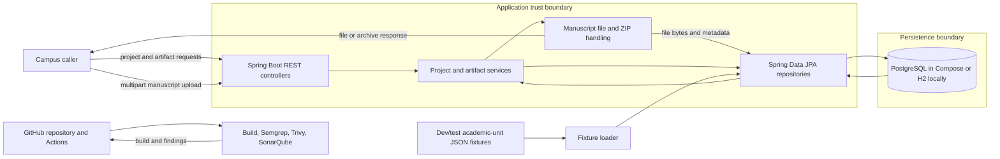

# Security Analysis of Domain 1

This analysis covers the happy-path implementation of the Domain 1, including its HTTP API, Spring services, persistence
layer, manuscript upload/download and ZIP generation, Docker Compose configuration and CI pipeline.

## Security requirements

1. **Identity and authorization:** Authenticate callers and authorize each operation against a project-level policy.
   Restrict destructive maintenance actions such as purge to a separate, audited role. Do not rely on UUID
   unpredictability as access control.
2. **Input and file handling:** Validate request shape, field lengths, enum values, UUIDs, and supported URL schemes.
   Apply explicit upload size and content-type limits; do not trust the supplied filename or media type. Generate
   storage identifiers and ensure every archive entry remains within its intended artifact directory after
   normalization.
3. **Data protection:** Use TLS for service/database connections where applicable, encrypt sensitive database and backup
   storage at rest, and restrict database roles to the operations the service needs. Never use a repository-visible
   password as a production fallback; load credentials from a secret manager and fail startup when production secrets
   are missing.
4. **Integrity and accountability:** Keep mutations transactional and auditable, especially project deletion, artifact
   deletion, file replacement, and purge. Establish retention and recovery procedures before enabling permanent
   deletion.
5. **Availability:** Bound upload and request sizes, apply rate limits and timeouts, monitor expensive searches and ZIP
   generation, and define operational limits for database storage and backups.
6. **Error handling and monitoring:** Return generic external errors while recording actionable internal diagnostics
   without exposing stack traces, database details, credentials, or manuscript contents. Alert on repeated authorization
   failures and destructive operations.
7. **Supply-chain controls:** Pin CI actions, scan source, dependencies, and container images, retain scan evidence, and
   make the required security gates run on the branch/revision being assessed.

## 3. Data-flow diagram

Trust boundaries exist between callers and the API, the application and its database, and the repository and CI
services. Local development uses H2; Docker Compose uses PostgreSQL.

## 4. Abuse cases and attack trees

Each tree labels its root **Goal**. **AND-n** labels are conjunctive prerequisites of their parent goal or subgoal;
every such prerequisite must hold. **OR-n** labels are alternative paths; any one is sufficient for its parent. **Leaf**
nodes are terminal preconditions or actions. The trees remain at abuse-case level rather than providing exploit
procedures.

### Abuse case A - Read or download a project artifact without permission

* **Goal:** Read project metadata or manuscript content without project authorization.
    * **AND-1:** Reach the public REST API.
        * **Leaf 1.1:** The project and artifact routes are exposed to callers.
    * **AND-2:** Identify a target project or artifact.
        * **OR-1:** Use the unauthenticated project search/list route or artifact-list routes.
        * **OR-2:** Use an identifier already obtained from another source.
    * **AND-3:** Request a read, file-download, or ZIP-export route.
        * **Leaf 1.2:** The route returns the requested object or file.
    * **AND-4:** No authentication or object-level authorization blocks the request.
        * **Leaf 1.3:** The baseline controllers do not establish caller identity or check project membership.

**Impact:** Disclosure of project metadata, member-role records, and uploaded manuscripts, subject to the deployment's
data classification.

### Abuse case B - Tamper with records or cause permanent data loss

* **Goal:** Change or permanently remove project data without an authorized role.
    * **OR-1:** Modify or soft-delete a project or artifact.
        * **AND-1:** Reach a project or artifact mutation route.
            * **Leaf 1.1:** `POST`, `PUT`, or `DELETE` routes are exposed by the REST controllers.
        * **AND-2:** Submit a mutation for a target object.
            * **Leaf 1.2:** The request reaches the corresponding service operation.
        * **AND-3:** No authentication or role/object-authorization check rejects the caller.
            * **Leaf 1.3:** The baseline has no API authorization boundary.
    * **OR-2:** Permanently purge soft-deleted records.
        * **AND-4:** Reach and invoke `POST /api/v1/projects/purge`.
            * **Leaf 2.1:** The controller exposes the purge route.
        * **AND-5:** The caller is not separately authorized for maintenance.
            * **Leaf 2.2:** The purge route has no maintenance-role check.

**Impact:** Integrity loss, service disruption, or irrecoverable deletion of soft-deleted projects and their owned data.

### Abuse case C - Cause unsafe archive extraction

* **Goal:** Cause a recipient to write outside the intended extraction directory when handling a manuscript ZIP.
    * **AND-1:** Supply or replace a manuscript file and control its original filename metadata.
        * **Leaf 1.1:** The caller supplies a path-bearing filename, which the upload route stores as provided.
    * **AND-2:** Obtain a generated manuscript ZIP.
        * **Leaf 1.2:** ZIP export includes the stored original filename in an entry path.
    * **AND-3:** A recipient extracts the archive with a tool that does not constrain entry paths to the destination
      directory.
        * **Leaf 1.3:** The service generates the archive but does not extract it itself.

**Impact:** Potential file overwrite during downstream extraction. The current service generates the ZIP; it does not
extract it on the server.

### Abuse case D - Gain database access using a retained default

* **Goal:** Access or alter persisted data using the repository's default database credential.
    * **AND-1:** The deployment omits `DB_PASSWORD`, so the fallback credential is active.
        * **Leaf 1.1:** Both application properties and Compose configuration define a password fallback.
    * **AND-2:** Obtain a network path to the database.
        * **OR-1:** The database is reachable from an untrusted network in the deployment.
        * **OR-2:** An attacker can act from a host or application environment that can reach the database.
    * **AND-3:** Use the repository-visible fallback credential to authenticate.
        * **Leaf 1.2:** The fallback value is present in version-controlled configuration.

**Impact:** Data disclosure or tampering if the deployment uses the fallback and the database is reachable. The
repository does not establish that a particular deployment is exposed.

## 5. Attack-surface map

| Entry point / asset                                                                       | Data or action                              | Highest-risk vectors                                           |
|-------------------------------------------------------------------------------------------|---------------------------------------------|----------------------------------------------------------------|
| `GET /api/v1/projects`                                                                    | Search and list projects                    | Unauthorized disclosure, expensive searches                    |
| `POST /api/v1/projects`                                                                   | Create project                              | Unauthorized creation, unvalidated content                     |
| `GET`, `PUT`, `DELETE /api/v1/projects/{projectId}`                                       | Read, replace, soft-delete project          | Broken object authorization, tampering, deletion               |
| `POST /api/v1/projects/purge` (repository addition)                                       | Permanently delete soft-deleted projects    | Missing authentication/authorization; high-impact data loss    |
| `GET /api/v1/projects/{projectId}/artifacts`                                              | List project artifacts                      | Unauthorized disclosure                                        |
| `GET /api/v1/projects/{projectId}/artifacts/{artifactType}`                               | List one artifact type                      | Unauthorized disclosure, query/resource use                    |
| `POST /api/v1/projects/{projectId}/artifacts/{repositories,manuscripts,videos}`           | Create artifacts                            | Unauthorized mutation, unvalidated metadata                    |
| `GET`, `PUT`, `DELETE /api/v1/projects/{projectId}/artifacts/{artifactType}/{artifactId}` | Read, replace, soft-delete artifact         | Object authorization, tampering, deletion                      |
| `POST /api/v1/projects/{projectId}/artifacts/manuscripts/{artifactId}/file`               | Upload/replace file                         | Filename and media-type trust, resource exhaustion             |
| `GET`, `DELETE /api/v1/projects/{projectId}/artifacts/manuscripts/{artifactId}/file`      | Download/remove file                        | Unauthorized disclosure or deletion                            |
| `GET /api/v1/projects/{projectId}/artifacts/manuscripts/download`                         | ZIP export                                  | Unsafe archive entry names, data disclosure, resource use      |
| `GET /api/v1/labs`, `/api/v1/departments`, `/api/v1/courses` (repository additions)       | List academic reference data                | Scope drift, data exposure                                     |
| Application-to-database connection                                                        | Persistent project, artifact, and file data | Default credentials, privilege misuse, unencrypted storage     |
| Docker Compose port 8080 and internal database service                                    | Runtime network boundary                    | Reachability, weak credentials, misconfiguration               |
| GitHub Actions workflows and secrets                                                      | Build, source/dependency/image scanning     | Supply-chain changes, secret exposure, missing branch coverage |

## 6. STRIDE analysis

| DFD component                        | Spoofing                                                  | Tampering                                            | Repudiation                              | Information disclosure                                          | Denial of service                                        | Elevation of privilege                                          |
|--------------------------------------|-----------------------------------------------------------|------------------------------------------------------|------------------------------------------|-----------------------------------------------------------------|----------------------------------------------------------|-----------------------------------------------------------------|
| Caller and network                   | No caller identity is established                         | Requests can alter records                           | No caller-bound audit trail              | Project and file reads lack caller checks                       | Repeated requests can consume service capacity           | Unauthenticated caller reaches privileged operations            |
| REST controllers                     | No authentication boundary                                | Request bodies and identifiers are accepted          | Mutations are not attributable           | Read routes return data without policy checks                   | Search, upload, and ZIP routes can consume resources     | No role check separates ordinary users from maintenance actions |
| Project/artifact services            | Caller context is absent                                  | Lifecycle and file state changes lack policy checks  | No audit event is recorded               | Services return stored metadata and files                       | Unbounded service-level work is not rate-limited         | Purge is available through the same public service boundary     |
| File/ZIP handling                    | Client controls filename metadata                         | Filename becomes part of ZIP path                    | Upload provenance is not recorded        | File download/ZIP access is not scoped                          | Large/repeated uploads and exports can consume resources | Unsafe archive paths can affect a recipient on extraction       |
| Repositories and database            | Shared service credentials identify the app, not the user | Database writes are not tied to caller authorization | No database audit requirement is defined | Stored manuscript bytes and metadata require storage protection | Database/storage exhaustion is not bounded by the spec   | Repository-visible fallback credentials may broaden access      |
| Fixture loader and runtime config    | Deployment profile/config may be mis-set                  | Fixtures or environment values may be changed        | Config changes need provenance           | Secrets and local data need protection                          | Misconfiguration can prevent startup or exhaust storage  | Default DB account may have broader-than-needed privileges      |
| GitHub Actions and external scanners | CI identities/secrets require protection                  | Workflow or dependency changes can alter builds      | Build/scanner evidence must be retained  | Logs must not expose secrets                                    | CI/resource exhaustion and dependency outages            | Workflow permissions or secrets could be misused                |

## 7. Findings and mitigations

| Finding                                                    | Defensive plan                                                                                                                                                                                          |
|------------------------------------------------------------|---------------------------------------------------------------------------------------------------------------------------------------------------------------------------------------------------------|
| Missing API authentication/authorization (CWE-862/CWE-306) | Authenticate callers; enforce object- and role-level authorization on every read/mutation; restrict purge to a separately authorized maintenance identity; audit destructive actions.                   |
| Unsafe ZIP entry path (CWE-22)                             | Store a generated server-side filename; when creating ZIPs, use a basename and normalized relative path, reject path separators/traversal components, and verify containment before writing each entry. |
| Default database credential (CWE-798)                      | Remove production password defaults; require an externally supplied secret, rotate credentials, use least-privilege DB accounts, and restrict DB network access.                                        |
| Manuscript data protection                                 | Classify uploads, encrypt storage/backups at rest, use TLS in transit, define retention, and audit authorized download/removal.                                                                         |
| Availability and request handling                          | Configure upload limits, throttling, timeouts, bounded work, monitoring, and recovery procedures.                                                                                                       |
| CI evidence gaps                                           | Run Semgrep, dependency/image scans, and SonarQube against the same A2 revision; retain raw logs and record skipped jobs rather than treating them as clean.                                            |
